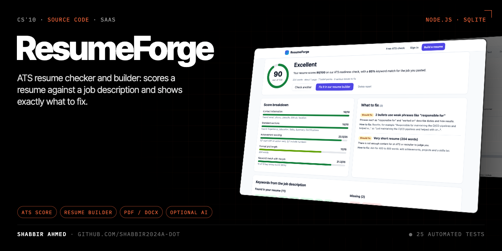
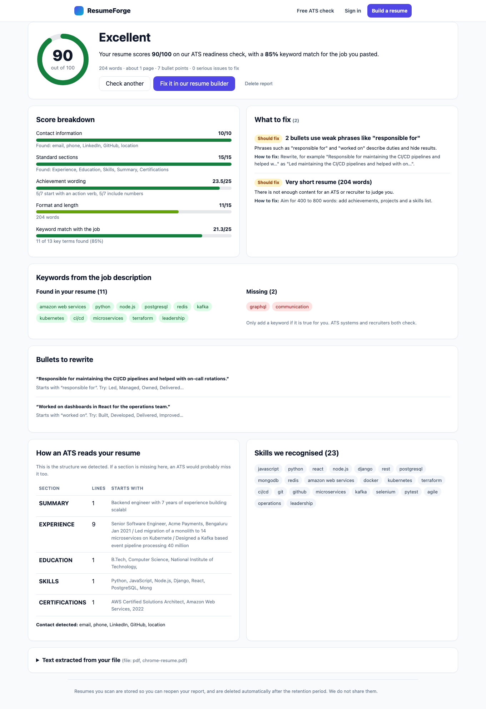
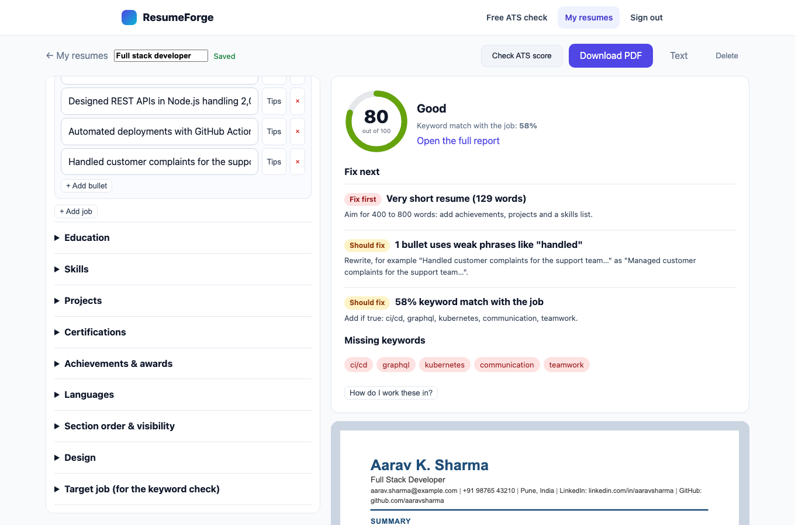

# ResumeForge

A resume checker and builder website. Visitors upload a resume and get an ATS score with specific fixes; signed-in users build an ATS-friendly resume with live preview, optional AI help and a clean PDF.

> The score estimates how a typical applicant tracking system reads a resume. It is not any vendor's real algorithm.

## Features

- Free ATS checker for PDF, DOCX or pasted text, scored 0-100 with a breakdown
- Keyword matching against a job description (~350 skills and synonyms)
- Resume builder with three templates and live preview
- Optional AI rewrites with your own key (OpenAI-compatible, Gemini or Claude)
- Admin area with limits, users and stats, plus a REST API

## Screenshots

**ATS report**

**Resume editor**

## Built with

Node.js 22+ with built-in SQLite · zero dependencies · 25 automated tests

## Get the source code

The source code is **not in this repository**. It is sold as a one-time purchase that includes the full code, a setup guide and a licence to run it for your business or clients.

---

Made by [Shabbir Ahmed](https://github.com/shabbir2024a-dot) · Guwahati, India
